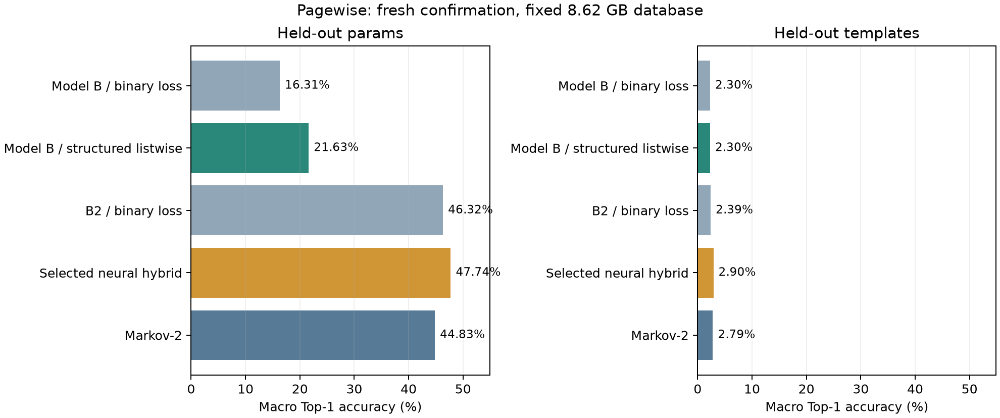
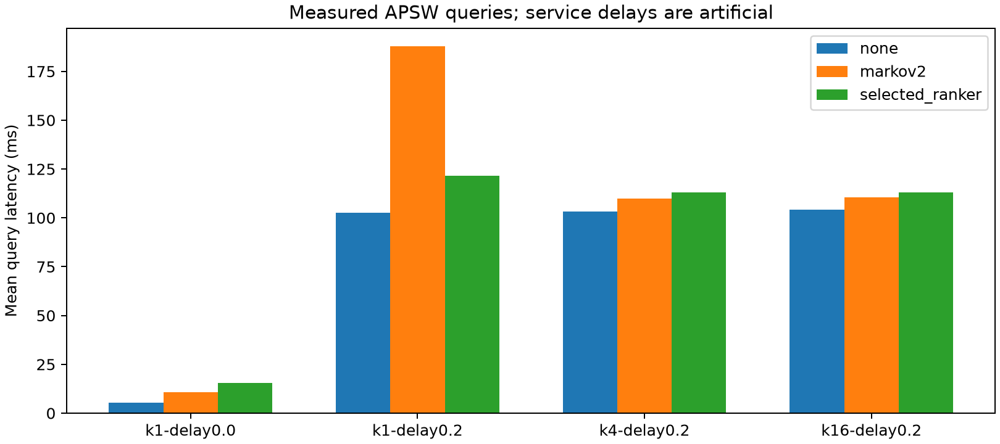

# Pagewise neural improvement results

On fresh unseen parameters, semantic Model B improved from **16.31% to 21.63%** macro Top-1 with structured features and listwise ranking. The selected neural–Markov hybrid reached **47.74%**, versus B2 **46.32%** and native Markov-2 **44.83%**. These are matched new-study results, not a comparison with the historical v2 corpus.

The frozen neural policy was slower than no prefetching in every measured runtime scenario. Prediction improved; query latency did not.

Fresh confirmation on the fixed 8.62 GB database; all eligible transitions evaluated without sampling.
Workload seeds: [921, 922, 923, 924, 925]. Weights, candidates, calibration and comparison family were frozen before these traces were collected.

## Prediction accuracy

Macro Top-1 is the mean query accuracy. Candidate failures count as errors.

| Split | Predictor | Macro Top-1 % | Micro Top-1 % | Micro Top-5 % | Candidate recall % |
|---|---|---:|---:|---:|---:|
| params | Selected neural hybrid | 47.743 | 34.973 | 35.976 | 58.380 |
| params | Markov-1 | 41.587 | 31.392 | 35.044 | n/a |
| params | Markov-2 | 44.826 | 33.876 | 35.338 | n/a |
| params | Contextual Markov | 42.357 | 32.012 | 35.298 | n/a |
| params | Model B / binary loss | 16.309 | 10.807 | 17.067 | 58.380 |
| params | B2 / binary loss | 46.319 | 34.076 | 35.534 | 58.380 |
| params | Hybrid without semantics | 45.720 | 33.724 | 36.101 | 58.380 |
| params | Model A / binary loss | 11.893 | 7.062 | 15.319 | 58.380 |
| params | Model B / listwise loss | 18.296 | 16.835 | 26.082 | 58.380 |
| params | Model B / structured listwise | 21.631 | 20.126 | 28.142 | 58.380 |
| templates | Selected neural hybrid | 2.899 | 1.821 | 3.113 | 20.681 |
| templates | Markov-1 | 2.737 | 1.703 | 2.057 | n/a |
| templates | Markov-2 | 2.791 | 1.759 | 2.060 | n/a |
| templates | Contextual Markov | 2.737 | 1.703 | 2.057 | n/a |
| templates | Model B / binary loss | 2.297 | 1.402 | 2.302 | 20.681 |
| templates | B2 / binary loss | 2.390 | 1.494 | 2.101 | 20.681 |
| templates | Hybrid without semantics | 2.899 | 1.821 | 3.113 | 20.681 |
| templates | Model A / binary loss | 2.297 | 1.402 | 1.965 | 20.681 |
| templates | Model B / listwise loss | 2.299 | 1.404 | 3.356 | 20.681 |
| templates | Model B / structured listwise | 2.299 | 1.589 | 3.060 | 20.681 |



## Paired effects

Positive percentage-point effects favor the named candidate. 95% hierarchical-bootstrap intervals resample independent workload seeds and paired queries within each seed. Holm corrects the entire frozen comparison family.

| Comparison | Delta pp | 95% CI | Holm p | Favorable support |
|---|---:|---|---:|---|
| params:b_structured_listwise_vs_b_bce | 5.322 | [3.595, 7.567] | 0.00140 | True |
| params:b_structured_listwise_vs_b_listwise | 3.335 | [2.779, 3.899] | 0.00140 | True |
| params:selected_vs_b2_bce | 1.424 | [1.081, 1.781] | 0.00140 | True |
| params:selected_vs_b_bce | 31.434 | [26.832, 36.103] | 0.00140 | True |
| params:selected_vs_hybrid_no_semantics | 2.023 | [1.546, 2.546] | 0.00140 | True |
| params:selected_vs_markov2 | 2.917 | [2.333, 3.589] | 0.00140 | True |
| templates:selected_vs_b2_bce | 0.509 | [0.435, 0.590] | 0.00140 | True |
| templates:selected_vs_b_bce | 0.602 | [0.498, 0.711] | 0.00140 | True |
| templates:selected_vs_markov2 | 0.108 | [0.044, 0.190] | 0.03900 | True |
| params:b_listwise_vs_b_bce | 1.988 | [0.328, 4.069] | 0.19498 | False |
| templates:b_listwise_vs_b_bce | 0.001 | [-0.020, 0.024] | 1.00000 | False |
| templates:b_structured_listwise_vs_b_bce | 0.002 | [-0.142, 0.157] | 1.00000 | False |
| templates:b_structured_listwise_vs_b_listwise | 0.001 | [-0.148, 0.166] | 1.00000 | False |
| templates:selected_vs_hybrid_no_semantics | 0.000 | [0.000, 0.000] | 1.00000 | False |

## Development selection

These scores are validation-only, sampled at most 16 transitions per query, and are not directly comparable to the full fresh-test scores. B3-based hybrids were screened but not promoted; their final confirmatory score is unavailable.

| Split | Trial | Variant | Loss | Validation macro Top-1 % | Best epoch |
|---|---|---|---|---:|---:|
| params | b2_bce | b2 | bce | 43.611 | 1 |
| params | b2_listwise | b2 | listwise | 46.370 | 4 |
| params | hybrid_no_semantics | b2 | listwise | 44.643 | 3 |
| params | hybrid_semantics | b2 | listwise | 46.960 | 9 |
| params | hybrid_structured | b3 | listwise | 46.731 | 5 |
| params | hybrid_structured_h128 | b3 | listwise | 46.888 | 9 |
| params | hybrid_structured_prior025 | b3 | listwise | 46.600 | 12 |
| params | hybrid_structured_lr003 | b3 | listwise | 46.788 | 6 |
| params | a_bce | a | bce | 12.220 | 5 |
| params | b_bce | b | bce | 10.905 | 15 |
| params | b_listwise | b | listwise | 16.717 | 16 |
| params | b_structured_listwise | b | listwise | 19.642 | 16 |
| params | b_bce_sampled | b | sampled_bce | 15.949 | 11 |
| params | b2_bce_sampled | b2 | sampled_bce | 45.102 | 5 |
| templates | b_bce | b | bce | 1.596 | 2 |
| templates | b2_bce | b2 | bce | 1.596 | 1 |
| templates | b2_listwise | b2 | listwise | 1.596 | 1 |
| templates | hybrid_no_semantics | b2 | listwise | 2.394 | 0 |
| templates | hybrid_semantics | b2 | listwise | 2.394 | 0 |
| templates | hybrid_structured | b3 | listwise | 2.394 | 0 |
| templates | hybrid_structured_h128 | b3 | listwise | 2.394 | 0 |
| templates | hybrid_structured_prior025 | b3 | listwise | 2.394 | 0 |
| templates | hybrid_structured_lr003 | b3 | listwise | 2.394 | 0 |
| templates | b_bce_sampled | b | sampled_bce | 1.596 | 1 |
| templates | b2_bce_sampled | b2 | sampled_bce | 1.596 | 1 |
| templates | a_bce | a | bce | 1.596 | 2 |
| templates | b_listwise | b | listwise | 1.596 | 1 |
| templates | b_structured_listwise | b | listwise | 1.729 | 3 |

## Runtime

The policy was selected on development seeds 107–108, then frozen. Confirmation runs 60 queries per seed per policy, cache 512 pages, one prefetch worker. Settings: degree 1, confidence threshold 0.7, predict every fourth miss. Negative latency effects favor prefetching.
The delay labels are requested artificial service times; the 0.2 ms sleep calibration achieved 0.5234 ms on this Windows host.

| Scenario | Policy | Mean ms | p95 ms | Queries |
|---|---|---:|---:|---:|
| k1-delay0.0 | none | 5.271 | 3.790 | 300 |
| k1-delay0.0 | markov2 | 10.596 | 14.518 | 300 |
| k1-delay0.0 | selected_ranker | 15.622 | 15.897 | 300 |
| k1-delay0.2 | none | 102.652 | 117.670 | 300 |
| k1-delay0.2 | markov2 | 187.777 | 177.177 | 300 |
| k1-delay0.2 | selected_ranker | 121.567 | 140.780 | 300 |
| k4-delay0.2 | none | 103.183 | 116.938 | 300 |
| k4-delay0.2 | markov2 | 109.923 | 125.934 | 300 |
| k4-delay0.2 | selected_ranker | 113.067 | 136.114 | 300 |
| k16-delay0.2 | none | 104.032 | 119.927 | 300 |
| k16-delay0.2 | markov2 | 110.601 | 128.266 | 300 |
| k16-delay0.2 | selected_ranker | 113.092 | 136.806 | 300 |

| Runtime comparison | Delta ms | 95% CI | Holm p | Favorable support |
|---|---:|---|---:|---|
| k1-delay0.0:markov2_vs_none | 5.325 | [2.968, 8.202] | 0.00160 | False |
| k16-delay0.2:markov2_vs_none | 6.569 | [4.094, 9.988] | 0.00160 | False |
| k16-delay0.2:selected_ranker_vs_none | 9.061 | [5.489, 13.492] | 0.00160 | False |
| k4-delay0.2:selected_ranker_vs_none | 9.884 | [6.037, 14.646] | 0.00160 | False |
| k4-delay0.2:markov2_vs_none | 6.740 | [4.002, 10.360] | 0.00240 | False |
| k1-delay0.0:selected_ranker_vs_none | 10.351 | [5.274, 16.618] | 0.00360 | False |
| k1-delay0.2:selected_ranker_vs_none | 18.915 | [9.654, 30.622] | 0.00480 | False |
| k1-delay0.2:markov2_vs_none | 85.124 | [37.603, 143.039] | 0.00480 | False |



### Runtime diagnosis

Useful rate divides useful prefetched pages by pages prefetched. Demand coverage below divides useful prefetched pages by all demand requests, not reference misses. Unused pages include evicted and still-resident unused prefetches. Scoring time includes candidate generation/features/ranking and divides by actually scored jobs, excluding stale jobs dropped before scoring. Foreground query latency also includes request scheduling and contention.

| Scenario | Prefetched | Useful | Useful % | Demand coverage % | Scoring ms/job | Queue wait ms/job | Stale drops |
|---|---:|---:|---:|---:|---:|---:|---:|
| k1-delay0.0 | 2228 | 2 | 0.090 | 0.003 | 1.266 | 27.874 | 4466 |
| k1-delay0.2 | 509 | 51 | 10.020 | 0.089 | 0.793 | 0.037 | 2 |
| k4-delay0.2 | 509 | 51 | 10.020 | 0.089 | 0.772 | 0.031 | 0 |
| k16-delay0.2 | 508 | 51 | 10.039 | 0.089 | 0.778 | 0.032 | 0 |

The JSON additionally retains queue drops, misses while prefetch was in flight and foreground device waiting. These are diagnostic counters, not a complete causal attribution of every latency regression. Exact timing-failure counts require an aligned reference-miss opportunity denominator; no offline timely-coverage claim is made.

## Generalization and errors

Held-out templates are an independent stress test. An epoch-zero selected residual checkpoint is a Markov fallback and provides no learned neural benefit.
Candidate recall limits every candidate ranker. The following rows pool all selected-model queries by template, including candidate misses.

| Split | Template | Queries | Transitions | Candidate misses % | Macro Top-1 % |
|---|---|---:|---:|---:|---:|
| params | created_range | 31 | 4815 | 67.061 | 1.796 |
| params | customer_orders | 89 | 2418 | 3.391 | 75.312 |
| params | customer_profile | 9 | 1596 | 0.940 | 12.631 |
| params | graph_walk | 32 | 1801 | 77.401 | 8.281 |
| params | order_items_join | 83 | 5949 | 6.623 | 79.483 |
| params | product_sales | 48 | 5850 | 72.154 | 4.307 |
| templates | created_range | 240 | 35165 | 76.246 | 0.948 |
| templates | order_items_join | 353 | 23662 | 83.886 | 4.226 |

## Simulator and evidence limits

The 60-cell grid returned **REOPEN_NO_HEADROOM**, with 40 reopened eligible concurrent cells.
This is exploratory virtual-time sensitivity, with a lower bound on headroom in a restricted action family {none, oracle-miss degree 1..2}. It is not a global scheduling bound or physical-device result.
Zero-delay none/null validation: 11 cells, 0 outside the 15% error target. Caches 64 and 256 were held out from CPU calibration.
The raw fit produced a negative hit cost. Original measurements are preserved; a separately recorded nonnegative fit fixes per-query overhead at zero because the three raw costs are not identifiable. Concurrent device timing and exact neural replay remain unvalidated, so simulator results do not overturn measured runtime findings.
Historical frozen manifest directories were absent locally (0 of 2 present); only the manifest file was available. Historical artifacts cannot be certified from that file alone.

## Reproduction and integrity

Frozen declaration SHA-256: `3aa428abe66762e5450d488406724bde8e9c70cd01f6d7bf1b8d7552631b528a`. Predictor source SHA-256: `67df304d39d11bc4fb14bd5679d5f5e7e4dd926f2370760820a831b1a122afd2`.
The frozen source archive and checkpoints are in `backend/runs/neural-improvement-20261020/frozen-final/`. Complete prediction tables are in that study's `confirmation/`; reused historical seeds 911–915 are explicitly labeled amended evidence in `amended/`.
Run from backend using `.venv/Scripts/python.exe`:

```text
scripts/evaluate_neural.py evaluate --frozen runs/neural-improvement-20261020/frozen-final --study runs/neural-improvement-20261020 --seeds 921,922,923,924,925 --out runs/neural-improvement-20261020/reproduction-confirmation --mode confirmatory
scripts/benchmark_neural_runtime.py --db runs/large-branch-20261015/pagewise-large.sqlite --frozen runs/neural-improvement-20261020/frozen-final --out runs/neural-improvement-20261020/reproduction-runtime --phase confirmatory --policy runs/neural-improvement-20261020/runtime-pilot-optimized/policy.json --queries 60
analysis/summarize_neural_study.py report
```

The collected trace and model artifacts are local ignored research outputs. This report and the compact dashboard export are tracked; a fresh clone needs the local database and frozen artifacts to reproduce this exact run.

Validation: 106 backend tests passed before confirmation. Final frontend and integrity checks are recorded in NEURAL_IMPROVEMENT_PLAN.md.
